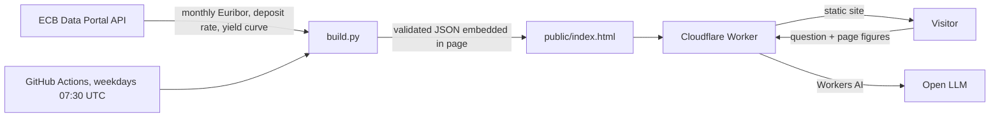

# Korkovahti: Euribor, made clear

**Live site: [korkovahti.euribor.workers.dev](https://korkovahti.euribor.workers.dev)**

An end-to-end data product that turns public ECB data into answers a home-loan
borrower can act on: where Euribor has been, where it stands, what markets
expect next, and what that means for the monthly payment.

*Korkovahti* is Finnish for "interest-rate watch". The primary audience is
Finnish borrowers, most of whose loans follow the 12-month Euribor. Spain,
Portugal, Italy and Austria are supported with their own conventions.

## Highlights

### Real data, refreshed automatically by GitHub Actions

[](https://github.com/banupriyaust/korkovahti/actions/workflows/refresh.yml)

Every number on the site is real. Nothing is mocked, sampled or typed in by
hand.

- **Official source.** All figures come straight from the European Central
  Bank's public API: 333 months of Euribor for four maturities, every deposit
  rate change since 1999, and the daily yield curve.
- **Hands-off pipeline.** A GitHub Actions workflow runs every weekday morning.
  It fetches the latest ECB data, validates it, rebuilds the page and commits
  the result only if something changed.
- **Automatic publishing.** That commit triggers Cloudflare to redeploy, so the
  live site updates with no manual step.
- **Auditable.** Each refresh is a commit, so the history of the data is the
  git history of this repository.

```
ECB API  ->  GitHub Actions (build.py: fetch, validate, build)  ->  git commit  ->  Cloudflare deploy  ->  live site
```

### An AI assistant on Cloudflare Workers AI, grounded in the data

The "Ask" box lets a visitor question the data in plain language, with no
login and at no cost to them or to me.

- **Grounded, not guessing.** Each question is sent together with the page's
  current figures, the market-implied path and the visitor's own loan inputs.
  The model is instructed to use those numbers exactly as given and never to
  invent a rate or a payment.
- **Guardrails in the prompt.** It must describe the outlook as market pricing
  and not as a forecast, mention the uncertainty, stay on the topic of rates
  and home loans, give no financial advice, and reply in the visitor's
  language.
- **Serverless and keyless.** A Cloudflare Worker serves the site and calls an
  open model (Llama 3.3 70B) through the Workers AI binding. There is no API
  key to store or leak.
- **Protected.** The endpoint only accepts requests from the site itself, and
  it caps the length of the question, the context and the conversation.
- **Zero running cost with a hard ceiling.** It runs inside the free daily
  Workers AI allowance. When that is used up the chat pauses until the next
  day and nothing is billed.
- **Always current.** Because the figures travel with each question, the
  assistant's answers follow every data refresh without retraining anything.

## Why I built it

Sites that publish Euribor show the number. They don't answer the questions a
borrower actually has:

- My rate resets in April. What will my payment be?
- Is the market expecting rates to rise or fall before then?
- I'm taking a new loan. How do 3, 6 and 12-month reference rates compare?
- How much uncertainty is there around any of this?

As a data analyst I wanted a project that goes past a dashboard: source the
data, model it, state the uncertainty plainly, and deliver it to people who are
not analysts.

## What it delivers

| Section | Question it answers | How |
|---|---|---|
| **Rates** | Where does each maturity stand? | Latest ECB monthly averages for 1, 3, 6 and 12 months, with year-on-year change |
| **History** | How did we get here? | 27 years of monthly data against the ECB deposit rate, with range filters and a yearly table |
| **Outlook** | What are markets pricing in? | A five-year market-implied path with an empirical uncertainty band |
| **Your loan** | What happens to my payment? | Annuity recalculation at the next reset, in three years, and under a 6 % stress test |
| **Ask** | What does this mean for me? | An AI assistant grounded in the page's own figures and the visitor's loan inputs |

### What the data says (build of 13 October 2026)

- The 12-month Euribor averaged **3.25 %** in September 2026, **1.08 points
  higher** than a year earlier, after two ECB rate rises in 2026.
- Since 1999 it has ranged from **5.39 %** (July 2008) to **-0.51 %**
  (January 2021), and was **negative for 74 consecutive months** (February 2016
  to March 2022).
- Markets imply roughly **3.55 %** in one year. Historically, half of all
  one-year moves fell outside a band of about -0.3 to +0.6 points around the
  expected path, which is why the page shows a range and not a single number.
- For a EUR 180,000 loan with 20 years left and a 0.75 % margin, that path
  means about **EUR 69 more per month** at an April 2027 reset.

## How it works



### Data pipeline (`build.py`)

- Pulls five datasets from the ECB's SDMX REST API: four Euribor maturities
  (monthly, from January 1999), the deposit facility rate, and the daily
  Svensson yield-curve parameters.
- Validates before publishing: every series must start in the same month and
  cover the same periods, and the calibration month must have enough curve
  observations. A failed check stops the build so bad data never reaches the
  site.
- Runs on a schedule in GitHub Actions and commits only when the data changed.
- Uses the Python standard library only. No dependencies to install.

### Analysis

**Market-implied path.** Forward rates are derived from the ECB's AAA
government-bond yield curve using the Svensson model:

```
f(t, m) = [ s(t+m)·(t+m) − s(t)·t ] / m
```

where `s` is the continuously compounded spot rate. Government-bond yields sit
below Euribor, so each maturity is shifted by the spread between the two,
calibrated over the latest full month (0.33 points for the 12-month rate).

**"Today" estimate.** The same spread applied to today's curve gives a current
estimate between official monthly prints. Checked against the real fixing of
12 October 2026 it was within 0.07 points.

**Uncertainty band.** For each horizon from 1 to 60 months, the band is the
interquartile range of every historical move over that horizon since 1999,
centred on the market path and smoothed across neighbouring horizons. It is
empirical and assumes no distribution.

**Loan maths.** Standard annuity formula, with the payment recalculated at
each reset from the remaining balance and remaining term. The stress test uses
the Finnish FSA's affordability guideline of 6 % over at most 25 years.

### Visualisation

Charts are hand-written SVG with no charting library, which keeps the whole
page at about 55 KB. Design decisions:

- One y-axis per chart, never dual axes.
- A colour-blind-safe two-colour palette, with a legend and a table view so
  colour is never the only cue.
- Hover crosshair and tooltips on every chart.
- Light and dark themes, and a layout that works on a phone.

### AI assistant

Each question is sent with a compact summary of the page's figures and the
visitor's loan inputs, plus fixed rules: use only those numbers, describe the
outlook as market pricing and not a forecast, and give no financial advice.
The model has no memory and learns nothing from visitors. It runs on
Cloudflare Workers AI's free allowance, so visitors need no account.

## Back-test: how good is the outlook?

A forecast you can't score is just an opinion, so I tested the method against
22 years of history. [`backtest.py`](backtest.py) rebuilds the outlook for
every month since the ECB yield curve began (September 2004), using only the
data that was available at the time, and compares it with the Euribor that was
actually published later. Full tables: [`backtest/results.md`](backtest/results.md).

Two simple benchmarks are scored the same way: **no change** (the rate stays
where it is) and **history** (the median past move over the same horizon).
Errors are mean absolute errors in percentage points; lower is better.

**12-month Euribor**

| Horizon | Origins | Market path | No change | History | Bias | Inside band (target 50 %) | Direction right* |
|---|---|---|---|---|---|---|---|
| 6 months | 259 | 0.43 | 0.43 | 0.45 | +0.05 | 68 % | 65 % |
| 12 months | 253 | **0.77** | 0.78 | 0.81 | +0.13 | 63 % | 63 % |
| 24 months | 241 | 1.47 | **1.29** | 1.32 | +0.43 | 48 % | 44 % |
| 36 months | 229 | 2.07 | **1.50** | 1.51 | +0.86 | 31 % | 27 % |

**3-month Euribor**

| Horizon | Origins | Market path | No change | History | Bias | Inside band (target 50 %) | Direction right* |
|---|---|---|---|---|---|---|---|
| 6 months | 259 | **0.33** | 0.40 | 0.41 | +0.06 | 68 % | 71 % |
| 12 months | 253 | **0.67** | 0.76 | 0.79 | +0.12 | 66 % | 71 % |
| 24 months | 241 | 1.36 | **1.28** | 1.35 | +0.38 | 54 % | 46 % |
| 36 months | 229 | 2.00 | **1.47** | 1.52 | +0.80 | 42 % | 23 % |

\* Share of months where the market priced a move of at least 0.10 points and
the rate then moved in that direction.

**12-month Euribor, 12 months ahead, by period**

| Period | Origins | Market path | No change | Bias |
|---|---|---|---|---|
| Pre-crisis (2004 to 2007) | 40 | **0.64** | 0.85 | -0.50 |
| Financial and euro debt crises (2008 to 2014) | 84 | 1.14 | **0.89** | +1.11 |
| Negative rates (2015 to 2021) | 84 | 0.36 | **0.33** | -0.11 |
| Inflation and rate hikes (2022 to 2025) | 45 | **0.95** | 1.32 | -0.67 |

### What the back-test shows

- **Up to a year ahead the outlook earns its place.** For the 3-month rate it
  beats both benchmarks (0.67 against 0.76 points a year out); for the
  12-month rate it ties with "no change". When markets priced a clear move,
  the rate moved that way about two times in three.
- **Beyond two years it does worse than assuming no change.** The path is
  biased upwards by 0.4 to 0.9 points. That matches the term premium in bond
  yields, and it also reflects the long run of falling rates after 2008.
- **The uncertainty band is too wide in the short run and too narrow in the
  long run.** It contained the real outcome 63 to 68 % of the time within a
  year, against a 50 % target, but only 31 to 42 % of the time at three years.
- **It fails at turning points nobody priced.** In July 2008 the market
  implied 5.53 % for a year later; the actual figure was 1.41 % after the
  crisis cuts. In 2022 it was too low as the ECB raised rates faster than
  expected, yet over 2022 to 2025 it still beat "no change" by a wide margin,
  because markets did see the hikes and later the cuts coming.

The practical reading for a borrower: trust the direction and rough size of
the path for the next 6 to 12 months, and treat anything beyond two years as
an upper-leaning scenario, not an expectation.

### How the back-test was verified

- **No look-ahead.** Each month uses only that month's yield curve and
  Euribor, and the band uses only moves completed before that month.
- **Reproduces the live site.** For September 2026 it recovers the site's
  exact spread (0.3314 points).
- **Independent recalculation.** Sample months (July 2008, June 2021, October
  2023) and the no-change benchmark were recomputed separately and match.
- **Data.** 5,652 daily yield curves (266 months) and 333 months of Euribor,
  all from the ECB API.

One simplification: the back-test averages the curve over each origin month,
while the site uses the latest day's curve.

## Decisions worth noting

- **Data licensing.** Daily Euribor fixings belong to EMMI and need a licence
  to redistribute. The project uses only ECB-published data, which is free to
  reuse, and derives the current level instead of republishing fixings.
- **Honest uncertainty.** The outlook is labelled as market pricing, shown with
  a range, and the page states that half of real outcomes fell outside it.
- **Known bias, now measured.** Bond forwards include a term premium, so the
  path beyond two years sits above what later happened: by 0.4 to 0.9 points
  in the back-test. The page says so.
- **Zero running cost.** Free hosting, free data, free AI tier with a hard
  daily cap, so nothing can generate a bill.

## Skills this project demonstrates

| Area | Evidence |
|---|---|
| Data sourcing and APIs | ECB SDMX REST API, five datasets, CSV parsing |
| ETL and automation | Scheduled pipeline with validation gates and change-only commits |
| Time-series analysis | 27 years of monthly rates, horizon-based change distributions |
| Financial modelling | Svensson curve, forward rates, spread calibration, annuity schedules |
| Model validation | Out-of-sample back-test over 22 years, benchmarks, bias, interval coverage |
| Data visualisation | Custom SVG charts, accessible palette, responsive and themed |
| Communicating to non-analysts | Plain-language findings, explicit uncertainty, country-specific context |
| Data governance | Licensing review that shaped the data model |
| Product delivery | Serverless hosting, API backend, LLM integration with guardrails |

## Repository

| File | Purpose |
|---|---|
| `template.html` | The page: layout, charts, calculator and chat client |
| `build.py` | Data pipeline: fetches ECB data and writes `public/index.html` |
| `backtest.py` | Scores the outlook method against realised Euribor since 2004 |
| `backtest/` | Back-test results as JSON and Markdown |
| `public/index.html` | The built site |
| `worker.js` | Cloudflare Worker: serves the site and answers `/api/ask` |
| `wrangler.toml` | Cloudflare settings, including the AI model |
| `.github/workflows/refresh.yml` | Scheduled data refresh |

## Run it

```bash
python build.py
python backtest.py        # optional: re-run the back-test
python -m http.server 8000 --directory public
```

Then open `http://localhost:8000`. Everything works locally except the chat,
which needs the Cloudflare Worker.

## Deploy (free)

1. In Cloudflare, open **Workers & Pages**, choose **Create**, then
   **Import a repository**, and pick this repository. Leave the build command
   empty and keep the deploy command as `npx wrangler deploy`.
2. In this repository, open **Actions** and enable workflows so the data
   refreshes each weekday.

Workers AI gives 10,000 "neurons" a day for free. When they run out the chat
pauses until midnight UTC, and nothing is billed on the free plan. If the chat
stops answering after a model is retired, change `MODEL` in `wrangler.toml`.

## Limitations and next steps

- The "today" figure is an estimate, not the official fixing.
- The outlook comes from government-bond forwards, a proxy for Euribor futures.
- The chat has no per-visitor rate limit yet.
- The outlook is weaker than "no change" beyond two years (see the back-test).
- Planned: show the back-test on the site, shorten or flag the long end of the
  outlook, fixed-instalment loans, Finnish-language version.

## Data sources

- [ECB Data Portal](https://data.ecb.europa.eu): Euribor monthly averages
  (`FM` dataset), deposit facility rate, euro-area yield curve (`YC` dataset).
- Euribor is administered by the European Money Markets Institute.

## About

Built by **Banupriya Selvaraj**, data analyst and BI developer.
[LinkedIn](https://www.linkedin.com/in/banupriya-selvaraj) ·
[GitHub](https://github.com/banupriyaust)

Developed with Claude Code as a pair-programming assistant.

This project is for information only and is not financial advice.

© 2026 Banupriya Selvaraj. All rights reserved.
